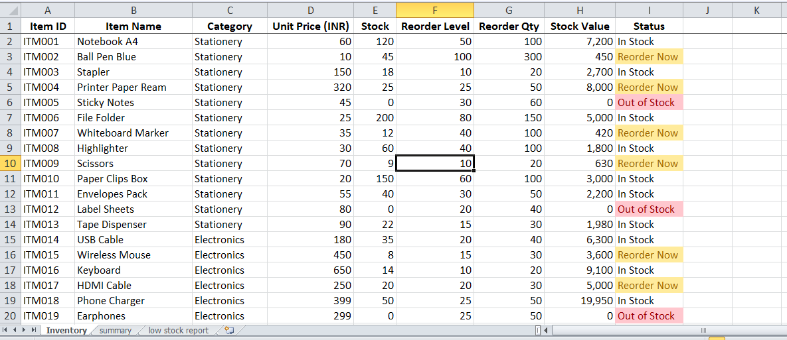

# Simple Inventory Tracker (Excel)

## Overview
A sheet that shows stock, reorder level and stock status for 25 items, with colour
highlighting and a low-stock report. The inventory data is synthetic (made-up), not from a real store.

## Workbook structure
- Inventory: the tracker (stock, reorder level, stock value, status)
- summary: counts of each status and total stock value
- low stock report: items that need to be reordered

## Rules
- Out of Stock: stock is 0
- Reorder Now: stock is less than or equal to the reorder level
- In Stock: stock is above the reorder level
- Check data: stock is blank
Out of Stock is shown in red and Reorder Now in yellow (conditional formatting).

## Results
- Out of Stock: 3, Reorder Now: 7, In Stock: 15 (25 items)
- Total stock value: 157,924
- The low-stock report has 10 items, and 690 units are suggested to order in total

## Tests
Items whose stock is exactly equal to the reorder level (Printer Paper Ream, HDMI Cable, Office
Chair) are marked Reorder Now. I also tested a stock of 0 and a blank stock.

## Tools Used
Microsoft Excel (IF, COUNTIF, SUM, conditional formatting, filter)

## Dataset
Synthetic inventory data (25 items)

## Screenshots

